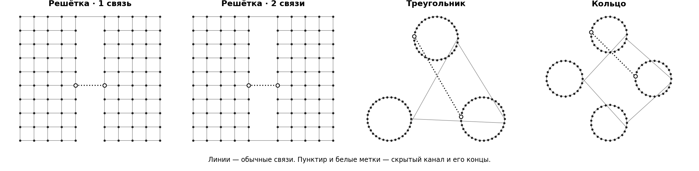
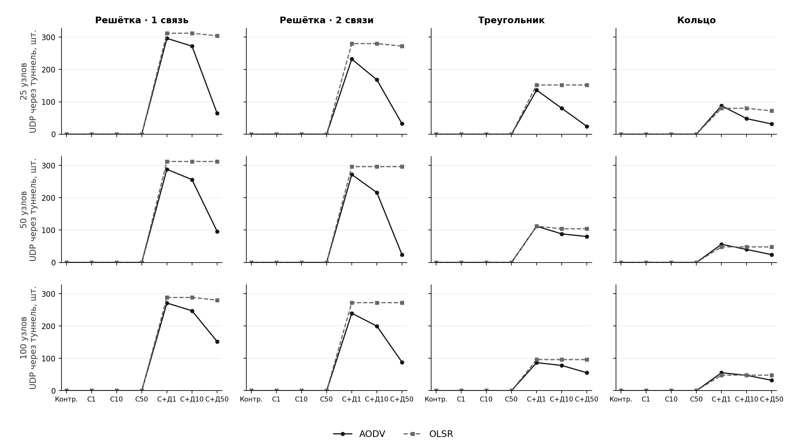

# Сравнительные испытания AODV и OLSR в NS-3.49

В наборе 5 040 прогонов для двух протоколов маршрутизации. Прогоны охватывают 25, 50 и 100 узлов, четыре схемы связности и четыре модели нарушений. Результаты собраны в 504 условия по 10 повторов и 252 парных сравнения AODV с OLSR.

## Файлы

| Материал | Содержание |
| --- | --- |
| [ZIP с журналами и данными](ns3-49-matched-5040-logs.zip) | 8 журналов JSONL, 8 журналов сборки, 8 журналов ошибок, три CSV, сведения о версиях и восемь графиков |
| [Курсовая работа, версия 12](BIT-221_Usin_kursovaya_chitaemye_shemy_v12.docx) | Протоколы, условия сравнения, разбор результатов и расшифровка полей данных |
| [Подробный отчёт Word](NS3_Otchet_5040_v2.docx) | Методика, графики по полной матрице и разбор характерных случаев |
| [Презентация PowerPoint](NS3_Sravnenie_5040_v2.pptx) | Схемы сети, сравнительные графики, таблицы и пояснения в заметках |

SHA-256 архива `eb946ad7b35b4d6dd229cd3925395c2e51a3f737ce916670e4a4853c3bc99915`. Внутри архива файл `SHA256SUMS.txt` содержит суммы каждого журнала, таблицы и графика.

## Что сравнивали

| Модель | Условия для одной топологии, размера и протокола | Прогонов на протокол | Всего |
| --- | --- | ---: | ---: |
| Чёрная дыра | Контроль, отбрасывание данных, отбрасывание с изменением служебного обмена | 360 | 720 |
| Серая дыра | Контроль и два режима отбрасывания при каждом из p = 0,25, 0,50, 0,75 | 840 | 1 680 |
| Wormhole | Контроль и два режима туннеля при каждой задержке 1, 10 и 50 мс | 840 | 1 680 |
| Сивилла | Контроль и 1, 3 или 10 фиктивных адресов | 480 | 960 |
| **Всего** | **21 вариант для каждой пары «размер, топология»** | **2 520** | **5 040** |

В серии четыре схемы связности. Решётка состоит из двух групп с одной или двумя обычными межгрупповыми связями. Треугольник соединяет три группы, кольцо — четыре. Обычные связи доступны в контрольных и активных режимах. На рисунке показаны схемы для 100 узлов.

Для каждого условия контроль использует тот же вариант модели с отключённым воздействием. При одинаковых топологии, размере сети и номере повтора совпадают источники, получатели, типы потоков и моменты их начала. Seed фиксирован на 49, номера повторов — от 1 до 10. Для выбранной модели положение нарушителя и, при наличии, второго участника также совпадает.

В прогоне восемь потоков UDP. Четыре идут между группами, четыре внутри групп. В каждом потоке запланировано 80 датаграмм по 128 байт с интервалом 250 мс. Это 320 отправок на каждый тип трафика и 640 на прогон. Межгрупповые показатели приведены отдельно, чтобы локальная доставка не скрывала потери между группами.

## Как рассчитаны показатели

- **PDR, %** — доставленные приложению датаграммы, делённые на 320 запланированных отправок для выбранного типа трафика, умноженные на 100. Например, 160 доставок дают 50%.
- **Задержка, мс** — в каждом прогоне сумма задержек полученных датаграмм, делённая на их число. В сводке берётся среднее таких значений по прогонам с доставкой. При нулевой доставке ячейка задержки пуста. Поле `*_n` показывает число прогонов, вошедших в среднее.
- **Разность протоколов, п. п.** — среднее десяти парных разностей `PDR AODV − PDR OLSR`. Положительное значение показывает больший PDR у AODV в данном условии.
- **Изменение относительно контроля, п. п.** — `PDR при воздействии − PDR в контроле` при том же номере повтора. Поле `attack_effect_diff_pp` сравнивает эти изменения для AODV и OLSR, поэтому учитывает разные уровни доставки в контроле.
- **95%-й интервал** — среднее плюс или минус указанная в CSV полуширина интервала Стьюдента. Для задержки с менее чем десятью доступными значениями полуширина оставлена пустой. Интервалы относятся к отдельным условиям и рассчитаны без поправки на множественные сравнения.

## Результаты на решётке из 100 узлов

В таблице одна обычная межгрупповая связь. Для чёрной и серой дыр выбран режим отбрасывания данных. Последние три колонки измеряются в процентных пунктах. Все значения — средние десяти прогонов.

| Режим | Контроль AODV, % | Контроль OLSR, % | PDR AODV, % | PDR OLSR, % | AODV − OLSR | Нижняя граница 95% | Верхняя граница 95% |
| --- | ---: | ---: | ---: | ---: | ---: | ---: | ---: |
| Чёрная дыра | 95,28 | 100,00 | 0,00 | 0,00 | 0,00 | 0,00 | 0,00 |
| Серая дыра, p = 0,50 | 95,28 | 100,00 | 47,44 | 49,66 | -2,22 | -5,84 | 1,40 |
| Wormhole, служебный, 1 мс | 95,28 | 100,00 | 14,88 | 10,00 | 4,88 | -6,31 | 16,06 |
| Wormhole, полный, 1 мс | 95,28 | 100,00 | 99,56 | 100,00 | -0,44 | -0,74 | -0,14 |
| Сивилла, 3 адреса | 95,28 | 100,00 | 95,28 | 0,00 | 95,28 | 89,62 | 100,94 |

### Чёрная дыра и роль обхода

На решётке с одной обычной связью межгрупповая доставка в основном режиме упала до нуля у обоих протоколов. При двух связях она составила 44,50% у AODV и 42,50% у OLSR. Это сравнение показывает, как положение нарушителя относительно доступных путей влияет на результат.

### Серая дыра и вероятность потери

| Вероятность отбрасывания у нарушителя | PDR AODV, % | PDR OLSR, % |
| --- | ---: | ---: |
| 0,25 | 71,00 | 74,53 |
| 0,50 | 47,44 | 49,66 |
| 0,75 | 24,09 | 25,44 |

Число p относится к пакетам, которые дошли до точки отбрасывания. PDR охватывает весь трафик между группами, включая доставку по обходным путям. При p = 0,50 и двух связях доставка составила 70,56% у AODV и 70,34% у OLSR. Дополнительное изменение служебного обмена учитывает особенности каждого протокола, поэтому этот режим рассматривается отдельно от отбрасывания данных.

### Wormhole и доставка через туннель

В служебном режиме туннель переносит служебные кадры и ARP. В полном режиме через него также могут пройти пользовательские датаграммы. При 1 мс и полном режиме из 320 межгрупповых отправок через туннель дошло в среднем 271,00 у AODV и 288,00 у OLSR. В служебном режиме этот счётчик равен нулю во всей серии. При задержке 50 мс средняя задержка доставленных пакетов в полном режиме составила 37,65 мс у AODV и 45,80 мс у OLSR.

На той же решётке разница между режимами видна при всех трёх размерах. В таблице межгрупповой PDR в процентах. В активных режимах задержка туннеля 1 мс.

| Узлов | Контроль AODV | Контроль OLSR | Служебный AODV | Служебный OLSR | Полный AODV | Полный OLSR |
| ---: | ---: | ---: | ---: | ---: | ---: | ---: |
| 25 | 99,88 | 100,00 | 7,50 | 2,50 | 100,00 | 100,00 |
| 50 | 96,69 | 100,00 | 10,00 | 2,50 | 99,94 | 100,00 |
| 100 | 95,28 | 100,00 | 14,88 | 10,00 | 99,56 | 100,00 |

### Сивилла и фиктивные маршруты

При трёх фиктивных адресах в журналах обоих протоколов учтено в среднем по 159 отправленных объявлений за прогон. В таблицах честных узлов AODV зарегистрировано 9 маршрутных записей, у OLSR — 297. Межгрупповой PDR OLSR на этой решётке упал со 100% до 0%, а внутригрупповой остался 100%. В AODV межгрупповой PDR остался на уровне контроля. Показатель `fake_routes` суммируется по узлам, поэтому один адрес может учитываться несколько раз.

## Где искать результаты своего условия

| Путь в ZIP | Единица записи | Как использовать |
| --- | --- | --- |
| `logs/*.jsonl` | Одна строка на прогон, всего 5 040 | Счётчики прогона и восемь потоков в массиве `flows`. Строка содержит JSON-массив из ключа и объекта результата |
| `logs/*-build.log` | Журнал сборки для каждой пары «протокол, модель» | Ход сборки. Локальный корень сборки заменён на `[build-root]` |
| `logs/*-errors.log` | Журнал ошибок для каждой пары «протокол, модель» | Все восемь файлов пусты |
| `data/runs.csv` | 5 040 строк данных | Показатели прогона, включая `run`, `cross_pdr`, `local_pdr` и счётчики |
| `data/summary.csv` | 504 строки данных | Средние по протоколу и условию, `*_n` и `*_ci95` |
| `data/paired.csv` | 252 строки данных | Разности AODV и OLSR и сравнение эффектов относительно контроля |
| `data/provenance.json` | Суммы SHA-256 | Идентификаторы исходников симулятора и восьми вариантов моделей |
| `figures/*.png` | 8 изображений | Топологии, PDR для четырёх моделей, доставка через туннель, шлюзы и фиктивные маршруты |

Например, для Wormhole на 100 узлах в решётке с одной связью отфильтруйте `summary.csv` по `attack = wormhole`, `topology = grid`, `redundant = 0` и `nodes = 100`. Сравните `off` с `control-only` и `control-and-data`, выбрав 1 мс для активных режимов. Затем сопоставьте `cross_pdr`, `cross_tunneled` и `cross_delay_ms_n` в строках двух протоколов. Для проверки повторов используйте те же поля в `runs.csv` и `run` от 1 до 10. Параметры, неприменимые к данной модели, записаны со значениями по умолчанию.

Результаты относятся к статичным узлам и заданным графам связности. В модели туннеля отдельно меняется задержка. Его пропускная способность и независимые потери не моделируются. В серии используется фиксированный профиль трафика, поэтому выводы ограничены выбранными топологиями, размерами и режимами.
